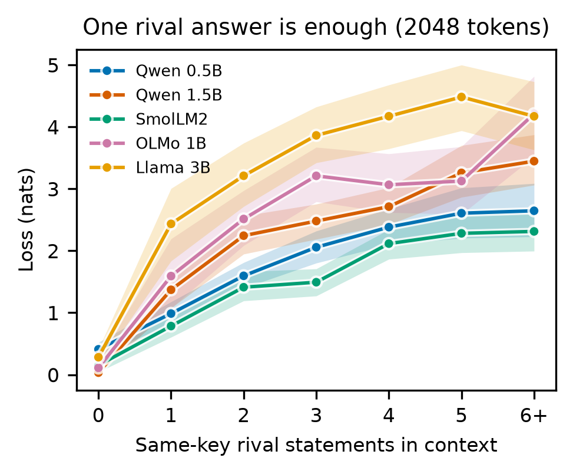
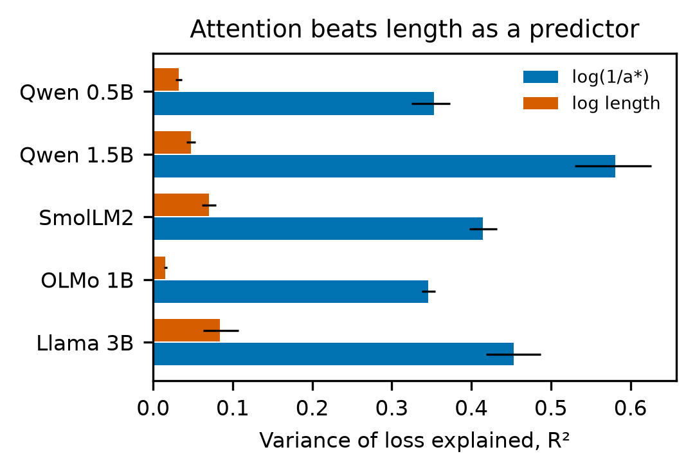
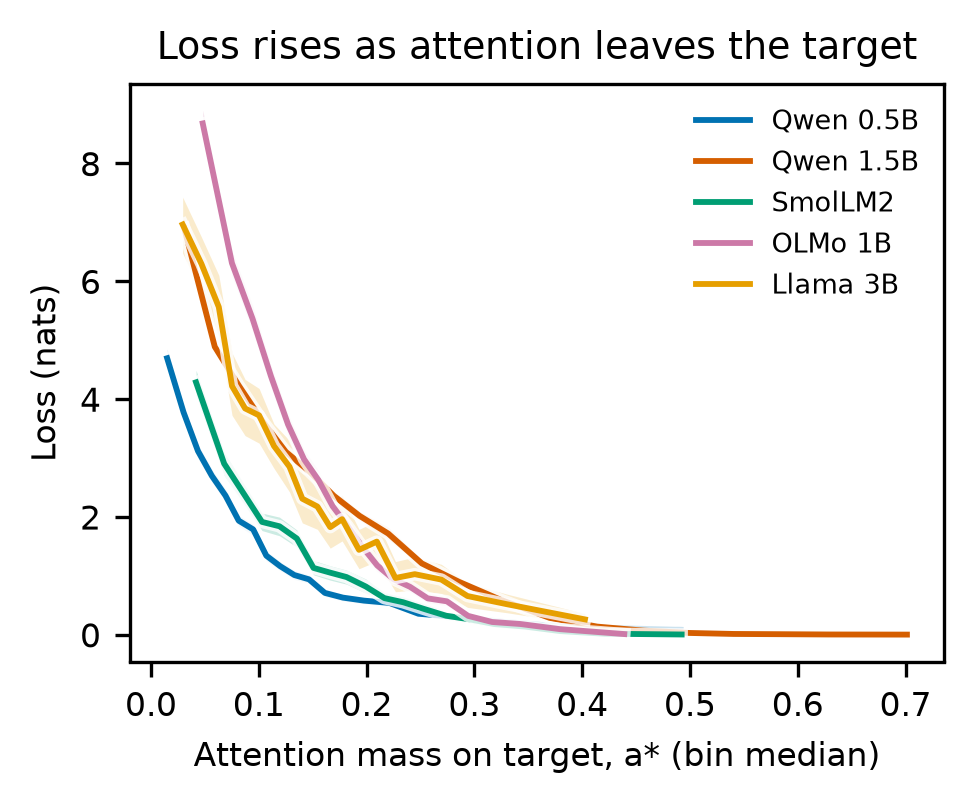
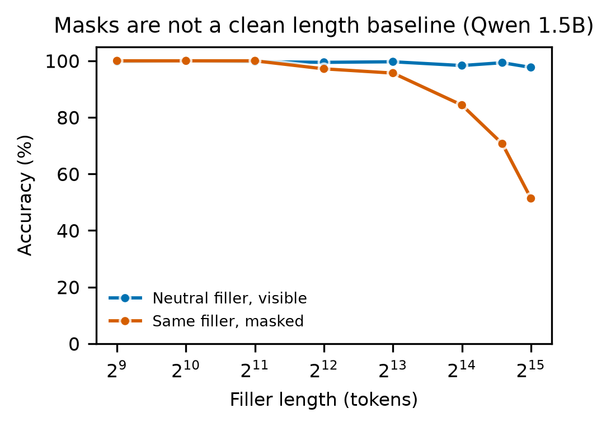
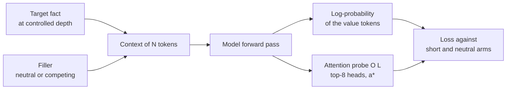

<div align="center">

# Length Is Cheap, Competition Is Not

### Attention predicts context rot in retrieval

Measurement code and trial-level data for 126,473 attention trials on five open models.

[](https://arxiv.org/abs/ARXIV_ID)
[](https://huggingface.co/datasets/yliusci/length-is-cheap)
[](https://orcid.org/0009-0006-1114-4781)

[](https://www.python.org/)
[](https://pytorch.org/)
[](https://github.com/huggingface/transformers)
[](LICENSE)
[](#data)
[](#models)
[](https://github.com/yliusci/length-is-cheap)

[**Results**](#key-results) ·
[**Quickstart**](#quickstart) ·
[**Reproduce**](#reproduce-the-figures) ·
[**Method**](#how-it-works) ·
[**Limits**](#limits) ·
[**Cite**](#citation)

</div>

---

## In one sentence

A long context barely hurts a model on its own: on neutral text, a 1.5B model keeps 96 to 99 percent accuracy at 32K tokens. Rival answers to the query do hurt, and the attention left on the target tracks that loss far better than length does.

<table>
<tr>
<td width="50%"></td>
<td width="50%"></td>
</tr>
<tr>
<td align="center"><b>Rival answers carry the loss.</b> Near zero without a rival.</td>
<td align="center"><b>Attention beats length.</b> R² 0.35 to 0.58 against 0.02 to 0.08.</td>
</tr>
<tr>
<td width="50%"></td>
<td width="50%"></td>
</tr>
<tr>
<td align="center"><b>Loss rises as attention leaves the target.</b></td>
<td align="center"><b>Masks are not a clean length baseline.</b></td>
</tr>
</table>

## Key results

| Finding | Evidence |
|---|---|
| Length alone is cheap | Neutral filler at 32K tokens: median loss at most 0.004 nats, accuracy 96 to 99 percent (Qwen 1.5B) |
| Rival answers carry the loss | Loss 0.02 to 0.34 nats with no rival, 1.38 to 3.24 with at least one (5 models, up to 2048 tokens) |
| Attention tracks loss | R²(log(1/a*)) 0.35 to 0.58 against R²(log L) 0.02 to 0.08 on 126,473 trials |
| Masking has its own cost | Same neutral filler at 32K: 96 to 99 percent visible, 48 to 54 percent masked |
| Masked MMLU drops | Llama-3.2-3B 51.7 to 40.5 percent, Qwen2.5-7B 65.8 to 48.1 percent at 30K masked tokens (n=1000) |

<details>
<summary><b>Per-model attention fit</b></summary>

| Model | n | R²(log(1/a*)) [95% CI] | R²(log L) [95% CI] | Slope [95% CI] |
|---|---:|---|---|---|
| Qwen2.5-0.5B-Instruct | 32,318 | 0.353 [0.325, 0.373] | 0.032 [0.028, 0.036] | 1.40 [1.38, 1.42] |
| Qwen2.5-1.5B-Instruct | 40,632 | 0.581 [0.530, 0.626] | 0.047 [0.042, 0.054] | 2.22 [2.21, 2.24] |
| SmolLM2-1.7B-Instruct | 9,325 | 0.414 [0.397, 0.432] | 0.070 [0.062, 0.079] | 1.67 [1.63, 1.72] |
| OLMo-2-0425-1B-Instruct | 42,005 | 0.346 [0.337, 0.355] | 0.016 [0.013, 0.018] | 3.97 [3.91, 4.02] |
| Llama-3.2-3B | 2,193 | 0.453 [0.418, 0.487] | 0.084 [0.063, 0.108] | 2.75 [2.63, 2.88] |

Loss here is log-probability in the short context minus log-probability in the long context. Slopes differ across models, so there is no universal law.
</details>

<details>
<summary><b>Masked MMLU replication</b></summary>

Accuracy in percent, 95 percent Wilson interval, n=1000 per cell.

| Masked tokens | Llama-3.2-3B | Qwen2.5-7B-Instruct |
|---:|---|---|
| 0 | 51.7 [48.6, 54.8] | 65.8 [62.8, 68.7] |
| 3,750 | 44.7 [41.6, 47.8] | 62.6 [59.6, 65.5] |
| 7,500 | 42.4 [39.4, 45.5] | 54.5 [51.4, 57.6] |
| 15,000 | 39.3 [36.3, 42.4] | 49.4 [46.3, 52.5] |
| 30,000 | 40.5 [37.5, 43.6] | 48.1 [45.0, 51.2] |

</details>

> [!IMPORTANT]
> **Read this before reusing the data.** In `near_distractors`, keys were drawn from 51 words without excluding the target key. So about 1 filler sentence in 51 restates the queried key with a different value, and the context contradicts itself. This was an accident. It is why the results above speak of rival answers and not of similarity in general. Format similarity without rivals was not tested in isolation. `harness/measure_v4.py` excludes the key, adds a controlled one-rival arm, and is included here, but it has **not been run**: no v4 result is reported anywhere in this repository.

## How it works



**Task.** The context holds one fact, then a query:

```text
You are a careful assistant. Read the document and answer the question.
... filler ... The secret code of the river is 4821. ... filler ...
Question: what is the secret code of the river? Answer: The secret code of the river is
```

**Decomposition.** With `Lshort` (no filler), `Lneu` (neutral filler) and `Llong` (studied filler):

```text
distance    = Lshort - Lneu
competition = Lneu   - Llong
total       = Lshort - Llong
```

**Attention.** `harness/attn_probe.py` hooks each attention layer in a normal SDPA forward pass and recomputes attention for the selected query positions only, which costs O(L) per layer instead of O(L²). It matches eager attention within 1e-5. `a*` is the mean target mass over the 8 layer and head pairs with the most target mass in the short context, read at the last query token.

## Models

| Model | Window | C1 | C2 attention | Masked MMLU |
|---|---:|:---:|:---:|:---:|
| `Qwen/Qwen2.5-0.5B-Instruct` | 32,768 | up to 32K | up to 2048 | |
| `Qwen/Qwen2.5-1.5B-Instruct` | 32,768 | up to 32K | up to 32K | up to 4K |
| `HuggingFaceTB/SmolLM2-1.7B-Instruct` | 8,192 | up to 4K | up to 8K | |
| `allenai/OLMo-2-0425-1B-Instruct` | 4,096 | up to 2K | up to 2048 | |
| `meta-llama/Llama-3.2-3B` | 131,072 | up to 4K | up to 32K | up to 30K |
| `Qwen/Qwen2.5-7B-Instruct` | 32,768 | | | up to 30K |

Llama is a gated model: accept its license on Hugging Face first.

## Quickstart

```bash
git clone https://github.com/yliusci/length-is-cheap.git
cd length-is-cheap
python -m venv .venv && source .venv/bin/activate
pip install -r requirements.txt
```

<details open>
<summary><b>Measure attention on your own model</b></summary>

```python
import sys
sys.path.insert(0, "harness")
import torch
from transformers import AutoModelForCausalLM, AutoTokenizer
from attn_probe import probe

name = "Qwen/Qwen2.5-0.5B-Instruct"
tok = AutoTokenizer.from_pretrained(name)
model = AutoModelForCausalLM.from_pretrained(name, attn_implementation="sdpa").eval()

ids = tok("The code is 4821. What is the code? The code is", return_tensors="pt").input_ids
mask = torch.ones_like(ids)
pos = torch.arange(ids.shape[1])[None]
out, attn = probe(model, ids, mask, pos, [ids.shape[1] - 1], logits_to_keep=1)
print(attn.shape)  # layers, heads, selected positions, sequence length
```

</details>

<details>
<summary><b>Load the data</b></summary>

```python
import pandas as pd
base = "hf://datasets/yliusci/length-is-cheap/"
trials = pd.read_parquet(base + "c2_attention.parquet")
print(trials.groupby("model")[["loss", "a_star_mean"]].mean())
```

</details>

## Reproduce the figures

```bash
python scripts/make_figures.py
```

<details>
<summary><b>Rerun the measurements</b></summary>

Memory is the main risk. Run one model at a time, and leave at least 25 percent of memory free. All scripts stop by themselves when free memory runs low on macOS.

```bash
# Attention trials, one model
CTXROT_ONLY=Qwen/Qwen2.5-0.5B-Instruct CTXROT_DTYPE=float16 python harness/measure_c2.py q05 200

# Fit
python harness/fit_c2.py

# Corrected filler: near, one-rival and neutral arms at one length
CTXROT_ONLY=Qwen/Qwen2.5-0.5B-Instruct CTXROT_DTYPE=float16 python harness/measure_v4.py 2048 100 3600

# Masked MMLU, needs context/mmlu_test.jsonl
CTXROT_ONLY=meta-llama/Llama-3.2-3B python experiments/du_repro.py run mmlu 1000
```

Each result file records the seed of every trial.
</details>

## Repository

```text
experiments/   task, fillers, and the masked replication
harness/       attention probe, measurement, fits, search engine
scripts/       figures and the rival count from stored seeds
data/          aggregated tables behind every figure
figures/       PNG, PDF and SVG
```

## Data

Trial-level data is on [Hugging Face](https://huggingface.co/datasets/yliusci/length-is-cheap).

| File | Rows | Content |
|---|---:|---|
| `c1_retrieval.parquet` | 16,327 | Distance and competition trials, all fillers, up to 4K tokens |
| `c1_retrieval_long.parquet` | 4,574 | Same columns, Qwen 0.5B and 1.5B, 8K to 32K tokens |
| `c2_attention.parquet` | 126,473 | Attention trials, 512 to 2048 tokens |
| `c2_attention_long.parquet` | 11,433 | Same columns, Qwen 1.5B and Llama to 32K, SmolLM2 to 8K |
| `c2_nconf_sample.parquet` | 20,193 | Stratified sample with rival counts rebuilt from seeds |
| `mmlu_masked.parquet` | 18,000 | Masked MMLU, one row per question and length |

## Limits

- No intervention was run. `a*` is a correlate read in the same pass as the loss, not a proven cause.
- The 126,473-trial attention fit covers 512 to 2048 tokens. From 8K to 32K we measured 4,500 trials on Qwen2.5-1.5B and 2,933 on Llama-3.2-3B (R²(log(1/a*)) 0.32 and 0.33, R²(log L) 0.02 and 0.03), one synthetic task only.
- Rival count grows with length in this filler, so the two are not fully separated.
- The rival split was made after data collection, on a sample, and was not preregistered.
- `a*` is read at one query token and is not net of attention sinks.
- OLMo loses with neutral filler at 2048 tokens (accuracy 91 percent), and this is not explained.
- Visible whitespace filler drops Qwen 1.5B on MMLU from 59.1 to 36.0 percent at 4096 tokens.
- No visible arm exists at 3,750 to 30,000 tokens on MMLU, so the masked drop there is not attributed to any cause.
- Log-probabilities sum over 5 answer tokens on Qwen and SmolLM2, and 3 on OLMo and Llama, so nats are not strictly comparable across models.

## Citation

```bibtex
@article{liu2026context,
  author  = {Liu, Yinuo},
  title   = {Length Is Cheap, Competition Is Not: Attention Predicts Context Rot in Retrieval},
  journal = {arXiv preprint arXiv:ARXIV_ID},
  year    = {2026}
}
```

## License

Code is released under the [MIT License](LICENSE). The models and MMLU keep their own licenses.
